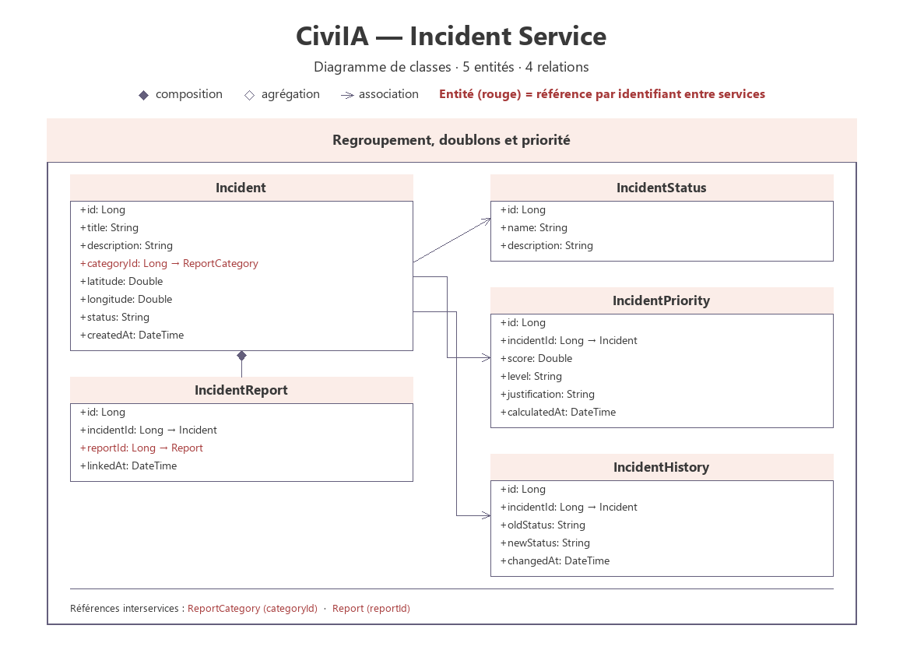

# Incident Service

## 1. Overview

The Incident Service is a backend microservice of the CiviIA platform. It is responsible for grouping individual reports into centralized incidents and for calculating their priority.

It provides REST APIs to create, retrieve, update and archive incidents.

## 2. Main Responsibilities

- Group similar reports into incidents.
- Detect duplicates by category and geographic proximity.
- Calculate and update the priority score of incidents.
- Maintain the status history of incidents.

## 3. Main Entities

### Incident
Represents a centralized urban incident.

Suggested attributes:
- id
- title
- description
- categoryId
- latitude
- longitude
- status
- createdAt

### IncidentReport
Represents the link between an incident and a report.

Suggested attributes:
- id
- incidentId
- reportId
- linkedAt

### IncidentStatus
Represents a status available for an incident.

Suggested attributes:
- id
- name
- description

### IncidentPriority
Represents the priority score of an incident.

Suggested attributes:
- id
- incidentId
- score
- level
- justification
- calculatedAt

### IncidentHistory
Represents a status change of an incident.

Suggested attributes:
- id
- incidentId
- oldStatus
- newStatus
- date

## 4. Technologies

- Java
- Spring Boot
- Spring Web
- Spring Data JPA
- Spring Validation
- MySQL (database)

## 5. API Endpoints

### Incident
| Method | Endpoint | Description |
|---|---|---|
| GET | `/api/incidents` | Get all incidents |
| GET | `/api/incidents/{id}` | Get incident by ID |
| POST | `/api/incidents` | Create incident |
| PUT | `/api/incidents/{id}` | Update incident |
| DELETE | `/api/incidents/{id}` | Archive incident |

### Incident Report
| Method | Endpoint | Description |
|---|---|---|
| GET | `/api/incidents/{id}/reports` | Get reports linked to an incident |
| POST | `/api/incidents/{id}/reports` | Link a report to an incident |
| DELETE | `/api/incidents/{id}/reports/{reportId}` | Unlink a report from an incident |

### Incident Priority
| Method | Endpoint | Description |
|---|---|---|
| GET | `/api/incidents/{id}/priority` | Get the priority of an incident |
| PUT | `/api/incidents/{id}/priority` | Update the priority of an incident |

## 6. Project Structure

```
incident-service/
├── src/
│   └── main/
│       ├── java/
│       └── resources/
├── pom.xml
└── README.md
```

## 7. Class Diagram



Full resolution: [class-diagram-incident-service.svg](../../Documentation/Diagrams/class-diagram-incident-service.svg)
