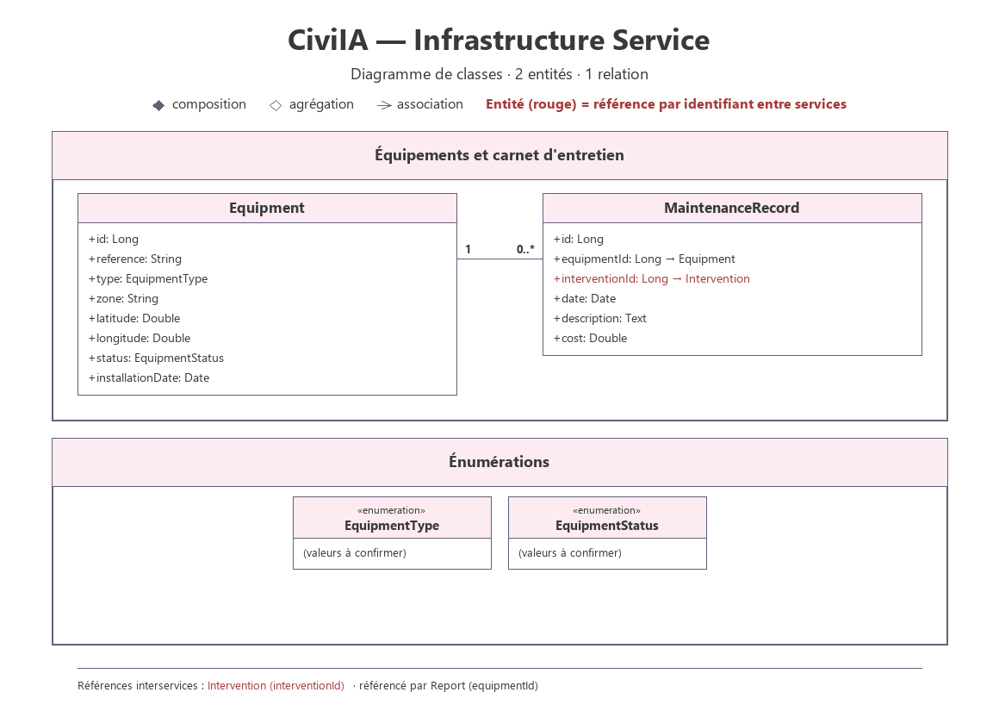

# Infrastructure Service

## 1. Overview

The Infrastructure Service is a backend microservice of the CiviIA platform. It manages the inventory of urban equipment and tracks its condition over time, like a digital maintenance log.

It provides REST APIs to create, retrieve, update and deactivate equipment and to record its maintenance history.

## 2. Main Responsibilities

- Manage the urban equipment inventory (reference, type, zone, position).
- Track the status of each equipment over time.
- Record the maintenance operations performed on an equipment.
- Provide the identifier of the equipment concerned by an incident to other microservices.

## 3. Main Entities

### Equipment
Represents an urban equipment registered in the platform.

Suggested attributes:
- id
- reference
- type (EquipmentType)
- zone
- latitude
- longitude
- status (EquipmentStatus)
- installationDate

### MaintenanceRecord
Represents a maintenance operation performed on an equipment.

Suggested attributes:
- id
- equipmentId
- interventionId
- date
- description
- cost

### Enumerations

| Enumeration | Values |
|---|---|
| EquipmentType | to be confirmed |
| EquipmentStatus | to be confirmed |

### Business Rules

- The reference of an equipment is unique.
- A `MaintenanceRecord` is created when an intervention is closed (event `InterventionClosed`) and links the equipment to that intervention.

Cross-service references are kept as external identifiers, without any inter-database foreign key:
- `MaintenanceRecord.interventionId` → Intervention Service (received through the `InterventionClosed` event)
- `Equipment.id` → provided to the Report Service (equipment concerned by an incident)

## 4. Technologies

- Java
- Spring Boot
- Spring Web
- Spring Data JPA
- MySQL (database)

## 5. API Endpoints

### Equipment
| Method | Endpoint | Description |
|---|---|---|
| GET | `/api/equipments` | Get all equipments (filters: zone, type, status, GPS proximity) |
| GET | `/api/equipments/{id}` | Get equipment by ID |
| POST | `/api/equipments` | Create equipment |
| PUT | `/api/equipments/{id}` | Update equipment |
| DELETE | `/api/equipments/{id}` | Deactivate equipment |

### Maintenance Record
| Method | Endpoint | Description |
|---|---|---|
| GET | `/api/equipments/{id}/maintenance-records` | Get the maintenance history of an equipment |
| POST | `/api/equipments/{id}/maintenance-records` | Add a maintenance record |
| PUT | `/api/maintenance-records/{id}` | Update a maintenance record |
| DELETE | `/api/maintenance-records/{id}` | Delete a maintenance record |

## 6. Project Structure

```
infrastructure-service/
├── src/
│   └── main/
│       ├── java/
│       └── resources/
├── pom.xml
└── README.md
```

## 7. Class Diagram



Full resolution: [class-diagram-infrastructure-service.svg](../../Documentation/Diagrams/class-diagram-infrastructure-service.svg)
