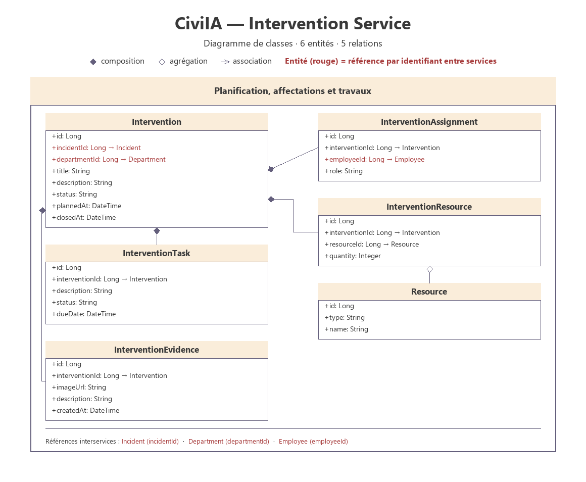

# Intervention Service

## 1. Overview

The Intervention Service is a backend microservice of the CiviIA platform. It is responsible for organizing the actions required to resolve incidents, from the creation of an intervention to its closure.

It provides REST APIs to create, retrieve, update and cancel interventions.

## 2. Main Responsibilities

- Manage interventions linked to incidents.
- Manage agent assignments and tasks.
- Manage the resources required by an intervention.
- Store before and after evidence of the work done.

## 3. Main Entities

### Intervention
Represents an operation planned to resolve an incident.

Suggested attributes:
- id
- incidentId
- departmentId
- title
- description
- status
- plannedAt

### InterventionAssignment
Represents the assignment of an employee to an intervention.

Suggested attributes:
- id
- interventionId
- employeeId
- role

### InterventionTask
Represents a task of an intervention.

Suggested attributes:
- id
- interventionId
- description
- status
- dueDate

### InterventionResource
Represents a resource used by an intervention.

Suggested attributes:
- id
- interventionId
- resourceId
- quantity

### InterventionEvidence
Represents an image or proof attached to an intervention.

Suggested attributes:
- id
- interventionId
- imageUrl
- description
- createdAt

## 4. Technologies

- Java
- Spring Boot
- Spring Web
- Spring Data JPA
- Spring Validation
- MySQL (database)

## 5. API Endpoints

### Intervention
| Method | Endpoint | Description |
|---|---|---|
| GET | `/api/interventions` | Get all interventions |
| GET | `/api/interventions/{id}` | Get intervention by ID |
| POST | `/api/interventions` | Create intervention |
| PUT | `/api/interventions/{id}` | Update intervention |
| DELETE | `/api/interventions/{id}` | Cancel intervention |

### Intervention Task
| Method | Endpoint | Description |
|---|---|---|
| GET | `/api/interventions/{id}/tasks` | Get tasks of an intervention |
| POST | `/api/interventions/{id}/tasks` | Add a task to an intervention |
| PUT | `/api/intervention-tasks/{id}` | Update a task |
| DELETE | `/api/intervention-tasks/{id}` | Delete a task |

### Intervention Evidence
| Method | Endpoint | Description |
|---|---|---|
| GET | `/api/interventions/{id}/evidence` | Get evidence of an intervention |
| POST | `/api/interventions/{id}/evidence` | Add evidence to an intervention |
| DELETE | `/api/intervention-evidence/{id}` | Delete intervention evidence |

## 6. Project Structure

```
intervention-service/
├── src/
│   └── main/
│       ├── java/
│       └── resources/
├── pom.xml
└── README.md
```

## 7. Class Diagram



Full resolution: [class-diagram-intervention-service.svg](../../Documentation/Diagrams/class-diagram-intervention-service.svg)
