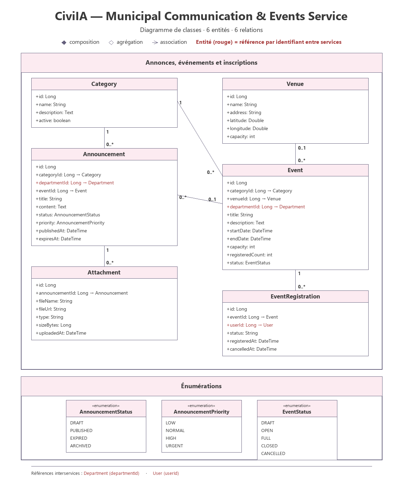

# Municipal Communication & Events Service

## 1. Overview

The Municipal Communication & Events Service is a backend microservice of the CiviIA platform. It carries the official communication of the municipality and the organisation of local events, like a digital notice board.

It provides REST APIs to create, retrieve, update and archive categories, announcements, attachments, events, registrations and venues.

## 2. Main Responsibilities

- Publish official announcements by category.
- Attach documents and media to an announcement.
- Organise local events in municipal venues.
- Manage event registrations and their capacity.

## 3. Main Entities

### Category
Represents a theme used to classify announcements and events.

Suggested attributes:
- id
- name
- description
- active

### Announcement
Represents an official announcement published by a department.

Suggested attributes:
- id
- categoryId
- departmentId
- eventId
- title
- content
- status (AnnouncementStatus)
- priority (AnnouncementPriority)
- publishedAt
- expiresAt

### Attachment
Represents a file attached to an announcement.

Suggested attributes:
- id
- announcementId
- fileName
- fileUrl
- type
- sizeBytes
- uploadedAt

### Event
Represents a local event organised by the municipality.

Suggested attributes:
- id
- categoryId
- venueId
- departmentId
- title
- description
- startDate
- endDate
- capacity
- registeredCount
- status (EventStatus)

### Venue
Represents a place that can host an event.

Suggested attributes:
- id
- name
- address
- latitude
- longitude
- capacity

### EventRegistration
Represents the registration of a user to an event.

Suggested attributes:
- id
- eventId
- userId
- status
- registeredAt
- cancelledAt

### Enumerations

| Enumeration | Values |
|---|---|
| AnnouncementStatus | DRAFT, PUBLISHED, EXPIRED, ARCHIVED |
| AnnouncementPriority | LOW, NORMAL, HIGH, URGENT |
| EventStatus | DRAFT, OPEN, FULL, CLOSED, CANCELLED |

### Business Rules

- A registration is refused when `registeredCount` has reached `capacity`; the increment must be atomic (optimistic lock or conditional update) to avoid overbooking during simultaneous registrations.
- A cancellation sets `cancelledAt` and decrements `registeredCount`.
- A user has only one active registration per event.
- `endDate` must be after `startDate`; if a venue is set, `capacity` must not exceed the capacity of the venue.
- An announcement whose `expiresAt` is passed becomes expired (scheduled task).

Cross-service references are kept as external identifiers, without any inter-database foreign key:
- `Announcement.departmentId`, `Event.departmentId` → Department (external identity directory)
- `EventRegistration.userId` → User (taken from the JWT)

## 4. Technologies

- Java
- Spring Boot
- Spring Web
- Spring Data JPA
- MySQL (database)

## 5. API Endpoints

### Category
| Method | Endpoint | Description |
|---|---|---|
| GET | `/api/categories` | Get all categories |
| GET | `/api/categories/{id}` | Get category by ID |
| POST | `/api/categories` | Create category |
| PUT | `/api/categories/{id}` | Update category |
| DELETE | `/api/categories/{id}` | Delete category |

### Announcement
| Method | Endpoint | Description |
|---|---|---|
| GET | `/api/announcements` | Get all announcements |
| GET | `/api/announcements/{id}` | Get announcement by ID |
| POST | `/api/announcements` | Create announcement |
| PUT | `/api/announcements/{id}` | Update announcement |
| DELETE | `/api/announcements/{id}` | Archive announcement |

### Attachment
| Method | Endpoint | Description |
|---|---|---|
| GET | `/api/announcements/{id}/attachments` | Get attachments of an announcement |
| POST | `/api/announcements/{id}/attachments` | Add an attachment to an announcement |
| DELETE | `/api/announcement-attachments/{id}` | Delete an attachment |

### Event
| Method | Endpoint | Description |
|---|---|---|
| GET | `/api/events` | Get all events |
| GET | `/api/events/{id}` | Get event by ID |
| POST | `/api/events` | Create event |
| PUT | `/api/events/{id}` | Update event |
| DELETE | `/api/events/{id}` | Cancel event |

### Event Registration
| Method | Endpoint | Description |
|---|---|---|
| GET | `/api/events/{id}/registrations` | Get registrations of an event |
| POST | `/api/events/{id}/registrations` | Register a user to an event |
| DELETE | `/api/event-registrations/{id}` | Cancel a registration |

### Venue
| Method | Endpoint | Description |
|---|---|---|
| GET | `/api/venues` | Get all venues |
| GET | `/api/venues/{id}` | Get venue by ID |
| POST | `/api/venues` | Create venue |
| PUT | `/api/venues/{id}` | Update venue |
| DELETE | `/api/venues/{id}` | Delete venue |

## 6. Project Structure

```
municipal-communication-events-service/
├── src/
│   └── main/
│       ├── java/
│       └── resources/
├── pom.xml
└── README.md
```

## 7. Class Diagram



Full resolution: [class-diagram-municipal-communication-events-service.svg](../../Documentation/Diagrams/class-diagram-municipal-communication-events-service.svg)
