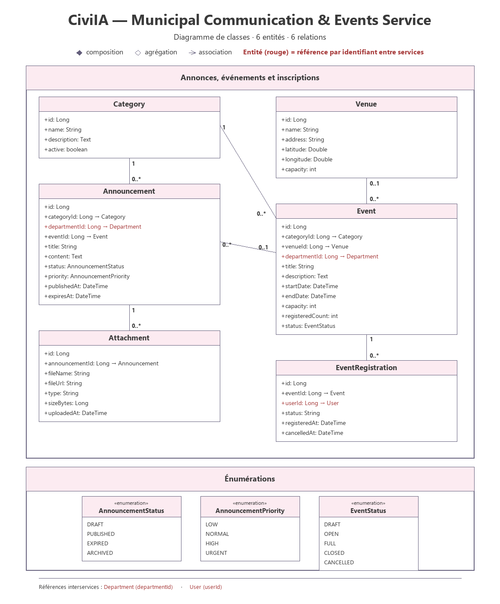

# Municipal Communication & Events Service

## 1. Présentation

Le **Municipal Communication & Events Service** est un microservice backend de la plateforme CivicPulse / CiviIA. Il assure la communication officielle de la municipalité et l'organisation des événements locaux, comme un panneau d'affichage numérique.

Le module est autonome : il ne référence les autres services que par identifiants (`departmentId`, `userId`), sans clé étrangère inter-bases (dossier technique § 4.6).

## 2. Responsabilités

- Publier des annonces officielles classées par catégorie.
- Joindre des fichiers et médias à une annonce.
- Organiser des événements dans des lieux municipaux.
- Gérer les inscriptions aux événements et leur capacité.

## 3. Modèle de données (dossier technique § 4.6)

| Entité | Attributs principaux |
|---|---|
| `Category` | id, name, description, active |
| `Announcement` | id, categoryId, departmentId, eventId, title, content, status, priority, publishedAt, expiresAt |
| `Attachment` | id, announcementId, fileName, fileUrl, type, sizeBytes, uploadedAt |
| `Event` | id, categoryId, venueId, departmentId, title, description, startDate, endDate, capacity, registeredCount, status |
| `Venue` | id, name, address, latitude, longitude, capacity |
| `EventRegistration` | id, eventId, userId, status, registeredAt, cancelledAt |

### Énumérations

| Énumération | Valeurs |
|---|---|
| `AnnouncementStatus` | DRAFT, PUBLISHED, EXPIRED, ARCHIVED |
| `AnnouncementPriority` | LOW, NORMAL, HIGH, URGENT |
| `EventStatus` | DRAFT, OPEN, FULL, CLOSED, CANCELLED |
| `RegistrationStatus` | REGISTERED, CANCELLED (valeurs proposées) |

### Règles métier

- Une inscription est refusée quand `registeredCount` a atteint `capacity`. L'incrément est protégé par un **verrou optimiste** (`@Version` sur `Event`) : en cas d'inscriptions simultanées, la seconde échoue avec un conflit 409.
- Une annulation renseigne `cancelledAt` et décrémente `registeredCount` ; un événement `FULL` repasse en `OPEN`.
- Un utilisateur n'a qu'une inscription active par événement.
- `endDate` est postérieure à `startDate` ; si un lieu est défini, `capacity` ne dépasse pas celle du `Venue`.
- Une annonce dont `expiresAt` est dépassée passe à `EXPIRED` (tâche planifiée, toutes les heures).
- `Category` est partagée entre annonces et événements (§ 8.3.4) : pas d'`AnnouncementCategory` séparée.

## 4. API

### Catégories — `/api/categories`
GET (liste), GET `/{id}`, POST, PUT `/{id}`, DELETE `/{id}`.

### Annonces — `/api/announcements`
GET (liste), GET `/{id}`, POST, PUT `/{id}`, POST `/{id}/publish`, DELETE `/{id}` (archive), GET `/{id}/attachments`, POST `/{id}/attachments`.

### Pièces jointes — `/api/announcement-attachments`
GET `/{id}`, DELETE `/{id}`.

### Événements — `/api/events`
GET (liste), GET `/{id}`, POST, PUT `/{id}`, POST `/{id}/open`, DELETE `/{id}` (annulation), GET `/{id}/registrations`, POST `/{id}/registrations`.

### Inscriptions — `/api/event-registrations`
GET `/{id}`, DELETE `/{id}` (annulation).

### Lieux — `/api/venues`
GET (liste), GET `/{id}`, POST, PUT `/{id}`, DELETE `/{id}`.

### Erreurs

Corps d'erreur unique `{ timestamp, status, error, message, path }` : 400 (validation), 404 (introuvable), 409 (capacité atteinte / doublon / accès concurrent), 422 (règle métier).

## 5. Technologies

Java 17 · Spring Boot 4.1.2 · Spring Web MVC · Spring Data JPA · Spring Validation · Lombok · MySQL (H2 en tests).

## 6. Structure

```
municipal-communication-events-service/
├── src/main/java/com/civia/municipalcommunicationeventsservice/
│   ├── MunicipalCommunicationEventsServiceApplication.java
│   ├── domain/model/          # 6 entites + enumerations
│   ├── domain/repository/     # repositories JPA
│   ├── service/               # regles metier + tache d'expiration
│   ├── web/                   # controleurs REST
│   ├── web/dto/               # requetes et reponses
│   └── exception/             # erreurs et gestionnaire global
├── src/main/resources/application.properties
└── src/test/java/             # tests unitaires et test de contexte
```

## 7. Diagramme de classes



Version haute résolution : [class-diagram-municipal-communication-events-service.svg](../../Documentation/Diagrams/class-diagram-municipal-communication-events-service.svg)

## 8. Lancement

```bash
./mvnw spring-boot:run
```

La base de données peut être configurée via `DB_URL`, `DB_USERNAME` et `DB_PASSWORD`.
