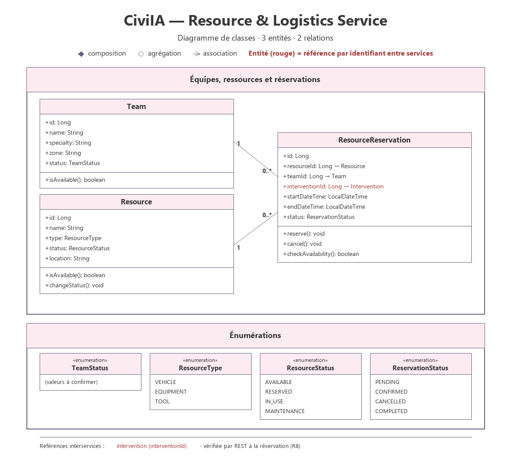

# Resource & Logistics Service

## 1. Overview

The Resource & Logistics Service is a backend microservice of the CiviIA platform. It handles the logistics of the interventions: the field teams, the material resources of the municipality and the reservations that link a resource and a team to an intervention over a time slot.

It provides REST APIs to create, retrieve, update and cancel teams, resources and reservations.

## 2. Main Responsibilities

- Manage the field teams and their specialties.
- Manage material resources (vehicles, equipment, tools) and their status.
- Reserve a resource for an intervention over a given time slot.
- Refuse any reservation that overlaps an active reservation of the same resource.

## 3. Main Entities

### Team
Represents a field team that can be assigned to an intervention.

Suggested attributes:
- id
- name
- specialty
- zone
- status (TeamStatus)

Suggested operations:
- isAvailable()

### Resource
Represents a material resource available to the municipality.

Suggested attributes:
- id
- name
- type (ResourceType)
- status (ResourceStatus)
- location

Suggested operations:
- isAvailable()
- changeStatus()

### ResourceReservation
Represents the reservation of a resource by a team for an intervention, over a time slot.

Suggested attributes:
- id
- resourceId
- teamId (optional)
- interventionId
- startDateTime
- endDateTime
- status (ReservationStatus)

Suggested operations:
- reserve()
- cancel()
- checkAvailability()

### Enumerations

| Enumeration | Values |
|---|---|
| ResourceType | VEHICLE, EQUIPMENT, TOOL |
| ResourceStatus | AVAILABLE, RESERVED, IN_USE, MAINTENANCE |
| ReservationStatus | PENDING, CONFIRMED, CANCELLED, COMPLETED |
| TeamStatus | to be confirmed |

### Business Rules

- `checkAvailability()` rejects any reservation whose time slot overlaps an active reservation of the same resource.
- `reserve()` is only possible when the resource is available; `cancel()` releases it.
- A team is available only if its status allows it and it has no reservation on the time slot.
- A reservation targets one resource (`resourceId`, required) and, optionally, one team (`teamId`).

Cross-service references are kept as external identifiers, without any inter-database foreign key:
- `ResourceReservation.interventionId` → Intervention Service (checked by REST at reservation time)

## 4. Technologies

- Java
- Spring Boot
- Spring Web
- Spring Data JPA
- MySQL (database)

## 5. API Endpoints

### Team
| Method | Endpoint | Description |
|---|---|---|
| GET | `/api/teams` | Get all teams |
| GET | `/api/teams/{id}` | Get team by ID |
| POST | `/api/teams` | Create team |
| PUT | `/api/teams/{id}` | Update team |
| DELETE | `/api/teams/{id}` | Delete team |

### Resource
| Method | Endpoint | Description |
|---|---|---|
| GET | `/api/resources` | Get all resources |
| GET | `/api/resources/{id}` | Get resource by ID |
| POST | `/api/resources` | Create resource |
| PUT | `/api/resources/{id}` | Update resource |
| DELETE | `/api/resources/{id}` | Delete resource |

### Resource Availability
| Method | Endpoint | Description |
|---|---|---|
| GET | `/api/resources/{id}/availability` | Check resource availability |

### Reservation
| Method | Endpoint | Description |
|---|---|---|
| GET | `/api/reservations` | Get all reservations |
| GET | `/api/reservations/{id}` | Get reservation by ID |
| POST | `/api/reservations` | Create reservation |
| PUT | `/api/reservations/{id}` | Update reservation |
| DELETE | `/api/reservations/{id}` | Cancel reservation |

## 6. Project Structure

```
resource-logistics-service/
├── src/
│   └── main/
│       ├── java/
│       └── resources/
├── pom.xml
└── README.md
```

## 7. Class Diagram



Full resolution: [class-diagram-resource-logistics-service.svg](../../Documentation/Diagrams/class-diagram-resource-logistics-service.svg)
