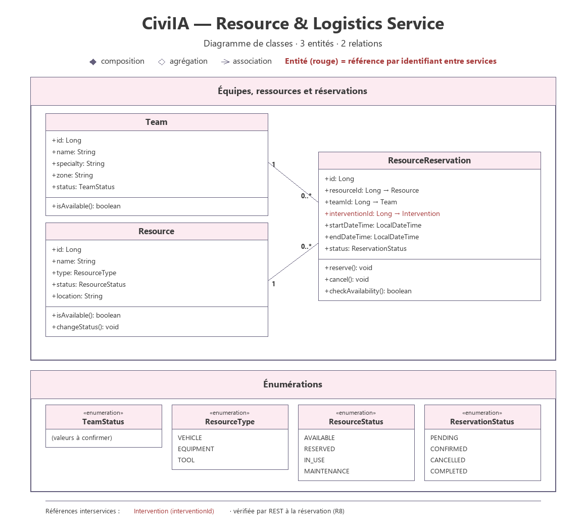

# Resource & Logistics Service

## 1. Présentation

Le **Resource & Logistics Service** est un microservice backend de la plateforme CivicPulse / CiviIA. Il gère la logistique, la planification et l'affectation des équipes et du matériel nécessaires aux interventions.

C'est le **seul propriétaire** de l'entité `Resource` (dossier technique, point de cohérence 8.1) : le service Intervention ne définit pas sa propre copie de cette notion. Les liens avec les autres services se font uniquement par identifiants (`interventionId`, `resourceId`, `teamId`).

## 2. Responsabilités

- Gérer les équipes (`Team`) et leur disponibilité.
- Gérer les ressources matérielles (`Resource`) et leur statut.
- Réserver des ressources et des équipes pour une intervention (`ResourceReservation`).
- Refuser les réservations qui se chevauchent sur une même ressource.
- Libérer les ressources à l'annulation d'une réservation.

## 3. Modèle de données (dossier technique § 4.5)

### Team

| Attribut | Type |
|---|---|
| id | Long |
| name | String |
| specialty | String |
| zone | String |
| status | `TeamStatus` (`AVAILABLE`, `UNAVAILABLE`, `MAINTENANCE` — valeurs proposées) |

Opération : `isAvailable()` — une équipe est disponible si son statut l'autorise **et** si elle n'a pas de réservation active sur le créneau demandé.

### Resource

| Attribut | Type |
|---|---|
| id | Long |
| name | String |
| type | `ResourceType` (`VEHICLE`, `EQUIPMENT`, `TOOL`) |
| status | `ResourceStatus` (`AVAILABLE`, `RESERVED`, `IN_USE`, `MAINTENANCE`) |
| location | String |

Opérations : `isAvailable()`, `changeStatus()`.

### ResourceReservation

| Attribut | Type |
|---|---|
| id | Long |
| interventionId | Long (référence logique vers Intervention) |
| resourceId | Long (**obligatoire**, § 8.3.3) |
| teamId | Long (optionnel, § 8.3.3) |
| startDateTime | LocalDateTime |
| endDateTime | LocalDateTime |
| status | `ReservationStatus` (`PENDING`, `CONFIRMED`, `CANCELLED`, `COMPLETED`) |

Opérations : `reserve()`, `cancel()`, `checkAvailability()`.

**Règles métier :**

- `checkAvailability()` refuse toute réservation dont l'intervalle chevauche une réservation active (`PENDING` ou `CONFIRMED`) de la même ressource. Deux intervalles qui se touchent exactement ne se chevauchent pas.
- `reserve()` n'est possible que si la ressource est disponible ; la réservation passe en `CONFIRMED` et la ressource en `RESERVED`.
- `cancel()` passe la réservation en `CANCELLED` et libère la ressource si aucune autre réservation active ne la retient.

## 4. API

Convention de nommage (style Auto-Loc) : `/<Entité>/<action>/{idEntité}`, par exemple `/Team/getTeam/{idTeam}`.

### Équipes — `/Team`

| Méthode | Endpoint | Description |
|---|---|---|
| POST | `/Team/addTeam` | Créer une équipe |
| GET | `/Team/getAllTeams` | Liste des équipes |
| GET | `/Team/getTeam/{idTeam}` | Équipe par identifiant |
| PUT | `/Team/updateTeam` | Remplacer une équipe |
| DELETE | `/Team/deleteTeam/{idTeam}` | Supprimer une équipe |
| GET | `/Team/isTeamAvailable/{idTeam}?startDateTime=...&endDateTime=...` | Disponibilité sur un créneau |

### Ressources — `/Resource`

| Méthode | Endpoint | Description |
|---|---|---|
| POST | `/Resource/addResource` | Créer une ressource |
| GET | `/Resource/getAllResources` | Liste des ressources |
| GET | `/Resource/getResource/{idResource}` | Ressource par identifiant |
| PUT | `/Resource/updateResource` | Remplacer une ressource |
| PATCH | `/Resource/changeStatus/{idResource}?status=...` | Changer le statut |
| DELETE | `/Resource/deleteResource/{idResource}` | Supprimer une ressource |
| GET | `/Resource/isResourceAvailable/{idResource}` | Disponibilité de la ressource |

### Réservations — `/Reservation`

| Méthode | Endpoint | Description |
|---|---|---|
| POST | `/Reservation/addReservation` | Créer/confirmer une réservation |
| GET | `/Reservation/getAllReservations` | Liste des réservations (filtre optionnel `?interventionId=`) |
| GET | `/Reservation/getReservation/{idReservation}` | Réservation par identifiant |
| PUT | `/Reservation/updateReservation` | Remplacer une réservation active |
| DELETE | `/Reservation/deleteReservation/{idReservation}` | Supprimer une réservation et libérer la ressource |
| POST | `/Reservation/cancelReservation/{idReservation}` | Annuler une réservation |

### Erreurs

Corps d'erreur unique : `{ timestamp, status, error, message, path }`.

| Code | Cas |
|---|---|
| 400 | Validation (champ manquant, intervalle invalide) |
| 404 | Entité introuvable |
| 409 | Conflit de réservation (chevauchement) |
| 422 | Règle métier violée (ressource/équipe indisponible) |

## 5. Technologies

Java 17 · Spring Boot 4.1.2 · Spring Web MVC · Spring Data JPA · Spring Validation · Lombok · MySQL (H2 en tests).

## 6. Structure

```
resource-logistics-service/
├── src/main/java/com/civia/resourcelogisticsservice/
│   ├── ResourceLogisticsServiceApplication.java
│   ├── domain/                # Team, Resource, ResourceReservation + énumérations
│   ├── repository/            # repositories JPA
│   ├── service/               # ITeamService, IResourceService, IResourceReservationService + implémentations
│   ├── controller/            # contrôleurs REST (entités en @RequestBody)
│   └── exception/             # erreurs et gestionnaire global
├── src/main/resources/application.properties
└── src/test/java/             # tests unitaires et test de contexte
```

L'organisation suit celle du projet **Auto-Loc** : entités et énumérations dans `domain`, repositories `@Repository` dans `repository`, contrats `I...Service` et leurs implémentations dans `service`, contrôleurs `@RestController` dans `controller` (injection par `@RequiredArgsConstructor`, entités en `@RequestBody`).

## 7. Diagramme de classes



Version haute résolution : [class-diagram-resource-logistics-service.svg](../../Documentation/Diagrams/class-diagram-resource-logistics-service.svg)

## 8. Lancement

```bash
./mvnw spring-boot:run
```

La base de données peut être configurée via `DB_URL`, `DB_USERNAME` et `DB_PASSWORD`.
