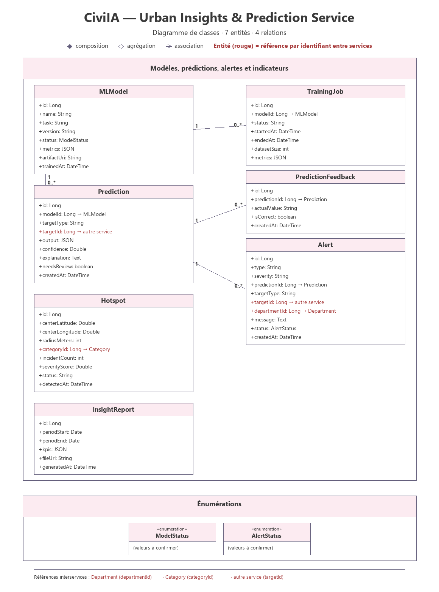

# Urban Insights & Prediction Service

## 1. Overview

The Urban Insights & Prediction Service is a backend microservice of the CiviIA platform. It is the transversal, analytics-oriented service: it subscribes to the events published by the other services, trains machine learning models on their data and returns predictions, risk zones and alerts.

It never modifies the data owned by the other services: it only publishes events and recommendations.

It provides REST APIs to manage machine learning models, training jobs, predictions, hotspots, alerts and insight reports.

## 2. Main Responsibilities

- Train and version machine learning models on the data of the platform.
- Suggest a priority and a category for a report.
- Predict the resolution time and the delay risk of an intervention.
- Detect incident hotspots (density clustering).
- Estimate the failure risk of an equipment.
- Measure citizen sentiment and satisfaction per neighbourhood and per intervention.
- Detect duplicate reports (text, coordinates, date similarity).
- Forecast the demand by category and zone.
- Publish predictions, alerts and recommendation events.

## 3. Main Entities

### MLModel
Represents a machine learning model registered in the platform.

Suggested attributes:
- id
- name
- task
- version
- status (ModelStatus)
- metrics (JSON)
- artifactUri
- trainedAt

### TrainingJob
Represents a training run of a model.

Suggested attributes:
- id
- modelId
- status
- startedAt
- endedAt
- datasetSize
- metrics (JSON)

### Prediction
Represents the output produced by a model for a given target.

Suggested attributes:
- id
- modelId
- targetType
- targetId
- output (JSON)
- confidence
- explanation
- needsReview
- createdAt

### PredictionFeedback
Represents the observed value used to measure a prediction.

Suggested attributes:
- id
- predictionId
- actualValue
- isCorrect
- createdAt

### Hotspot
Represents a zone with a high density of incidents.

Suggested attributes:
- id
- centerLatitude
- centerLongitude
- radiusMeters
- categoryId
- incidentCount
- severityScore
- status
- detectedAt

### Alert
Represents an alert raised from a prediction or a hotspot.

Suggested attributes:
- id
- type
- severity
- predictionId
- targetType
- targetId
- departmentId
- message
- status (AlertStatus)
- createdAt

### InsightReport
Represents a periodic report of key indicators.

Suggested attributes:
- id
- periodStart
- periodEnd
- kpis (JSON)
- fileUrl
- generatedAt

### Enumerations

| Enumeration | Values |
|---|---|
| ModelStatus | to be confirmed |
| AlertStatus | to be confirmed |

### Business Rules

- Only one active `MLModel` per task; activation requires metrics above a configured threshold.
- A prediction whose confidence is low is marked `needsReview` and is never applied automatically.
- An `Alert` is created when the failure probability exceeds a threshold or when a hotspot severity score crosses a severity level.
- `PredictionFeedback` measures the model drift and triggers a scheduled retraining.
- A `Hotspot` moves to `RESOLVED` when the number of incidents falls back below the threshold.

Cross-service references are kept as external identifiers, without any inter-database foreign key:
- `Prediction.targetId` → target entity of another service (report, equipment, intervention…), depending on `targetType`
- `Hotspot.categoryId` → Category (Municipal Communication & Events)
- `Alert.departmentId` → Department (external identity directory)

The service consumes the events of the other services (`ReportCreated`, `ReportStatusChanged`, `InterventionPlanned`, `InterventionClosed`, `MaintenanceRecorded`) and publishes recommendation events.

## 4. Technologies

- Java
- Spring Boot
- Spring Web
- Spring Data JPA
- MySQL (database)
- Python (FastAPI, scikit-learn) for the ML engine
- MLflow for model versioning and metrics

## 5. API Endpoints

### Model
| Method | Endpoint | Description |
|---|---|---|
| GET | `/api/models` | Get all models |
| GET | `/api/models/{id}` | Get model by ID |
| POST | `/api/models` | Create model |
| PUT | `/api/models/{id}` | Update model |
| DELETE | `/api/models/{id}` | Delete model |
| POST | `/api/models/{id}/train` | Start a training job |
| POST | `/api/models/{id}/activate` | Activate a model |

### Training Job
| Method | Endpoint | Description |
|---|---|---|
| GET | `/api/training-jobs` | Get all training jobs |
| GET | `/api/training-jobs/{id}` | Get training job by ID |
| POST | `/api/training-jobs` | Create training job |
| DELETE | `/api/training-jobs/{id}` | Delete training job |

### Prediction
| Method | Endpoint | Description |
|---|---|---|
| GET | `/api/predictions` | Get all predictions |
| GET | `/api/predictions/{id}` | Get prediction by ID |
| POST | `/api/predict/report-priority` | Suggest priority and category of a report |
| POST | `/api/predict/resolution-time` | Predict the resolution time of an intervention |
| POST | `/api/predictions/{id}/feedback` | Record prediction feedback |
| GET | `/api/equipments/{id}/failure-risk` | Estimate the failure risk of an equipment |

### Hotspot
| Method | Endpoint | Description |
|---|---|---|
| GET | `/api/hotspots` | Get all hotspots |
| GET | `/api/hotspots/{id}` | Get hotspot by ID |
| POST | `/api/hotspots/detect` | Run hotspot detection |
| DELETE | `/api/hotspots/{id}` | Delete hotspot |

### Alert
| Method | Endpoint | Description |
|---|---|---|
| GET | `/api/alerts` | Get all alerts |
| GET | `/api/alerts/{id}` | Get alert by ID |
| PUT | `/api/alerts/{id}` | Update alert |

### Insight Report
| Method | Endpoint | Description |
|---|---|---|
| GET | `/api/insight-reports` | Get all insight reports |
| GET | `/api/insight-reports/{id}` | Get insight report by ID |
| GET | `/api/analytics/kpis` | Get the platform key indicators |

## 6. Project Structure

```
urban-insights-prediction-service/
├── src/
│   └── main/
│       ├── java/
│       └── resources/
├── pom.xml
└── README.md
```

## 7. Class Diagram



Full resolution: [class-diagram-urban-insights-prediction-service.svg](../../Documentation/Diagrams/class-diagram-urban-insights-prediction-service.svg)
