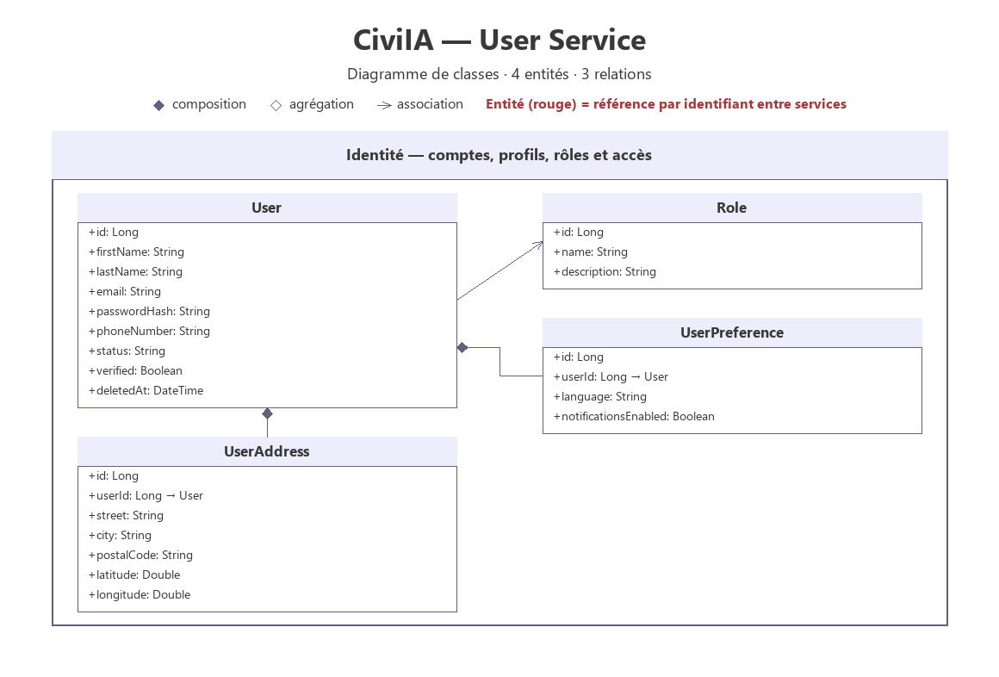
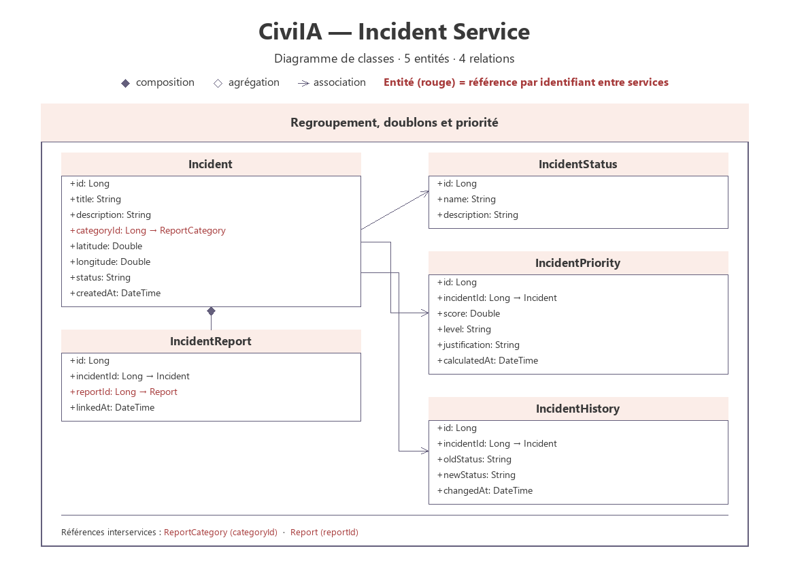
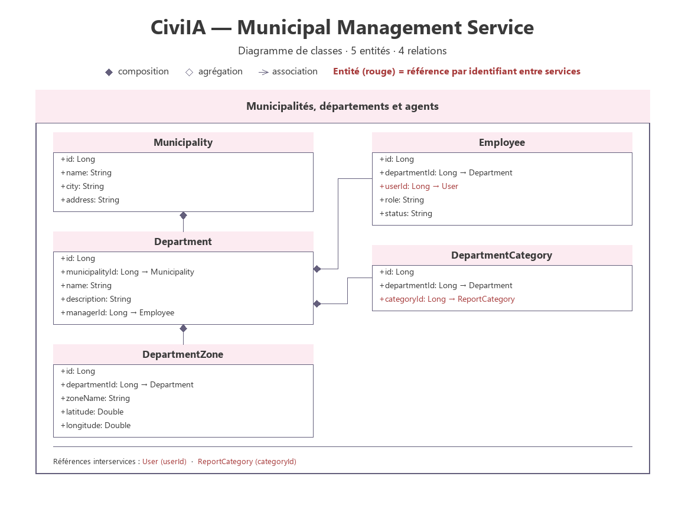
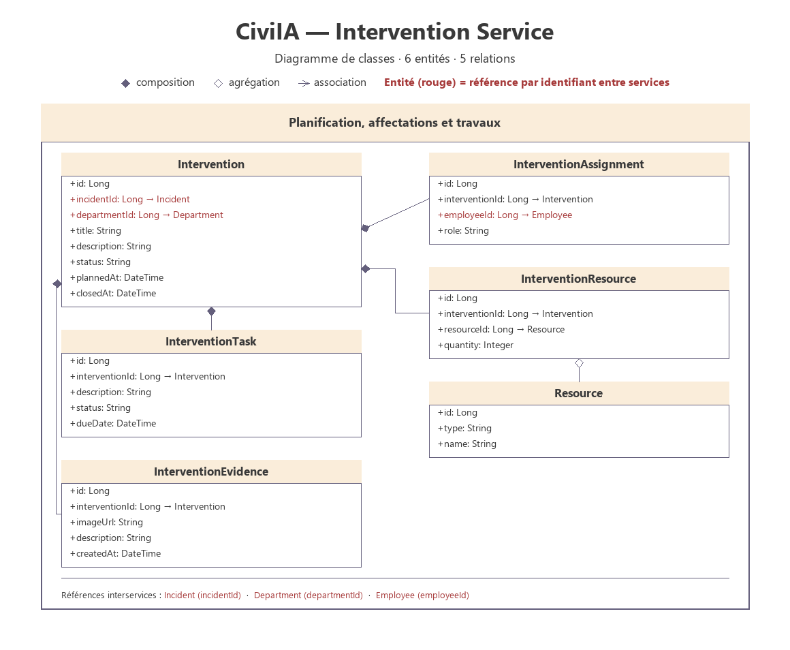

# Diagrammes de classes — CiviIA

Diagrammes de classes des 6 microservices de la plateforme **CiviIA**, établis à partir de la
spécification `CivicPulse — Architecture finale`.

Tous les diagrammes partagent le même thème :

- un en-tête pastel par microservice ;
- les relations UML : composition (◆), agrégation (◇), association (→) ;
- les attributs en **rouge** sont des références à une entité d'un autre service, par
  identifiant, sans clé étrangère inter-base.

## Diagrammes par microservice

| Microservice | Entités | Diagramme |
|---|---|---|
| User Service | 4 | [PNG](class-diagram-user-service.png) · [SVG](class-diagram-user-service.svg) |
| Report Service | 4 | [PNG](class-diagram-report-service.png) · [SVG](class-diagram-report-service.svg) |
| Incident Service | 5 | [PNG](class-diagram-incident-service.png) · [SVG](class-diagram-incident-service.svg) |
| Municipal Management Service | 5 | [PNG](class-diagram-municipal-management-service.png) · [SVG](class-diagram-municipal-management-service.svg) |
| Intervention Service | 6 | [PNG](class-diagram-intervention-service.png) · [SVG](class-diagram-intervention-service.svg) |
| Citizen Engagement Service | 5 | [PNG](class-diagram-citizen-engagement-service.png) · [SVG](class-diagram-citizen-engagement-service.svg) |

Le service Intervention comporte 6 classes : les 5 entités du PDF, plus `Resource`
(référencée par `InterventionResource.resourceId`).

## 1. User Service

Domaine : identité — comptes, profils, rôles et accès.

## 2. Report Service

Domaine : signalements, photos et catégories.

## 3. Incident Service

Domaine : regroupement, doublons et priorité.

## 4. Municipal Management Service

Domaine : municipalités, départements et agents.

## 5. Intervention Service

Domaine : planification, affectations et travaux.

## 6. Citizen Engagement Service

Domaine : confirmations, commentaires et évaluations.

